# Scientific Calculator

**A clean, minimal scientific, financial and graphing calculator for macOS, Windows and Linux.**
It starts as a small, simple calculator and expands into a full workstation. Pick the
**calculator type** you need — Scientific, Financial, Statistics, Programmer or All in one —
and only those tools are shown: graphs, equation solving, matrices, statistics and hypothesis
tests, loans, investments and cash flows, unit conversion and a programmer mode, all in one
fast native app that works completely offline.

<p align="center">
  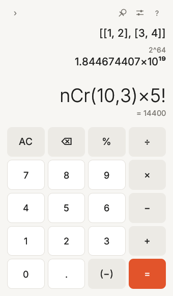
  &nbsp;
  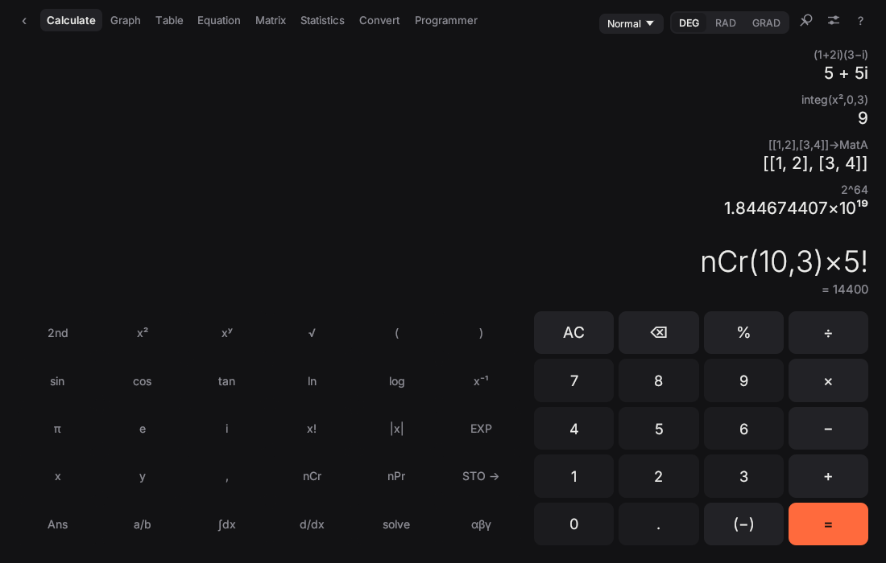
</p>

## Download

| System | File | How to install |
| --- | --- | --- |
| **macOS** (Apple silicon, M1 or later) | [Scientific-Calculator-2.0.0-macOS-AppleSilicon.zip](downloads/Scientific-Calculator-2.0.0-macOS-AppleSilicon.zip) | Unzip, drag **Scientific Calculator** to Applications. The first time, right-click the app and choose **Open** (the app is not notarised yet). |
| **Windows** 10 / 11 (64-bit) | [Scientific-Calculator-2.0.0-Windows-Setup.exe](downloads/Scientific-Calculator-2.0.0-Windows-Setup.exe) | Run the installer and follow the steps. If SmartScreen appears, choose **More info → Run anyway** (the installer is not code-signed yet). |
| **Linux** – Debian, Ubuntu, Mint | [scientific-calculator_2.2.0_amd64.deb](downloads/scientific-calculator_2.2.0_amd64.deb) | `sudo apt install ./scientific-calculator_2.2.0_amd64.deb` |
| **Linux** – any other distribution | [Scientific-Calculator-2.2.0-Linux-x86_64.tar.gz](downloads/Scientific-Calculator-2.2.0-Linux-x86_64.tar.gz) | Extract it and run `./install.sh` (no root needed). |

All downloads are in the [`downloads`](downloads) folder: click a file, then the download button.
Intel Macs and other systems can [build from source](#build-from-source) in a few minutes.

## Who it is for

- **School and college students**: algebra, trigonometry, logarithms, calculus, statistics and
  graphs, with a calculator that shows answers as fractions, multiples of π and square roots.
- **Engineers and scientists**: complex numbers, matrices, simultaneous equations, a numeric
  solver, integrals and derivatives, unit conversion and physical constants.
- **Teachers**: a clear, uncluttered display that is easy to show on a projector, in light or
  dark mode.
- **Programmers and electronics hobbyists**: hexadecimal, binary and octal side by side, a bit
  grid, bitwise operations, shifts and rotates for 8, 16, 32 and 64-bit numbers.
- **Statistics and research students, analysts and researchers**: t, z, F and χ² tests, one- and
  two-way ANOVA with Tukey post-hoc, non-parametric tests and correlation, with p-values, critical
  values and confidence intervals, without opening a spreadsheet.
- **Finance, business and accounting**: EMI and loan schedules, time value of money, NPV and IRR,
  compound interest and CAGR, depreciation, break-even, margins and GST, with digit grouping
  in international (1,234,567) or Indian (12,34,567) style.
- **Anyone** who wants a quick, good-looking desktop calculator that stays out of the way, and
  can stay on top of other windows while you work.

## Features

### Calculator types
Choose from the coloured button at the top left (or **View ▸ Calculator Type** on macOS, or Settings):

| Type | Tabs shown |
| --- | --- |
| **Scientific** | Calculate, Graph, Table, Equation, Matrix, Convert |
| **Financial** | Calculate, Finance, Statistics, Convert |
| **Statistics** | Calculate, Statistics, Graph, Table, Finance |
| **Programmer** | Calculate, Programmer, Convert |
| **All in one** | Everything |

The type only decides which tabs are shown; ⌘1, ⌘2 … follow the tabs you see. Your choice is remembered.

<p align="center">
  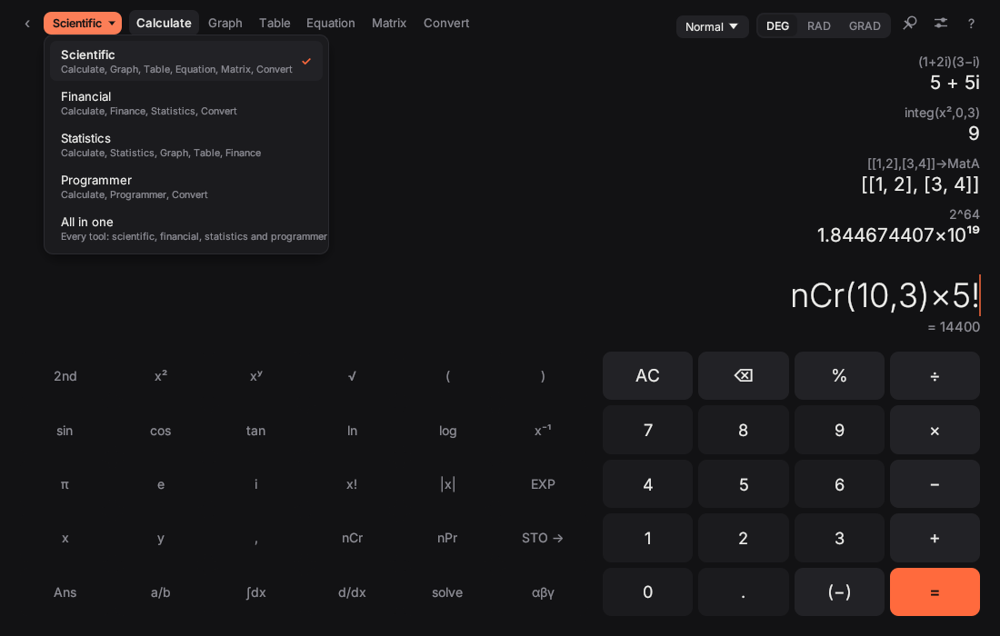
</p>

### Calculate
- Scientific keypad with second functions and a Greek-letter layer (α β γ θ λ ω …)
- Type naturally: `2x`, `3(4+1)`, `x^2` shows as x², `sqrt`, `pi` → π, `theta` → θ
- Live preview of the answer while you type; history you can click to reuse
- Exact answers: fractions, multiples of π and square-root forms (5/2, 3π/4, √2/2)
- Complex numbers, variables (`5 → A`), `Ans`, lists, matrices
- Calculus: derivatives, integrals, sums, products and a solver
- Degrees, radians or gradians; Normal, Fix and Sci number formats

### Graph and Table
- Up to six functions: y = f(x), polar r = f(θ), parametric (x(t), y(t)) and inequalities
  (`y < x^2`, `y ≥ 2x+1`) with the region shaded
- **Sliders**: any letter in a function (`a·x² + b`, `sin(k·x)`) becomes a slider you can drag or animate
- Roots, minimum and maximum, y-intercept and shaded definite integrals
- Derivative curve f′(x) and a tangent line with its slope wherever you hover
- Plot the Statistics data as points next to a function
- Intersections between every pair of curves, marked on the graph
- Trace the curves with the mouse, drag to pan, scroll or pinch to zoom
- Export the graph as a PNG (saved to Downloads and copied to the clipboard)
- Value tables for every function with any start, end and step

### Equation
- Polynomial roots up to degree 6, including complex roots
- Simultaneous linear equations with 2 to 6 unknowns
- Numeric solver for any equation, e.g. `cos(x) = x`, listing every solution in a range

### Matrix
- Six matrices (A–F) up to 6 × 6
- Determinant, inverse, transpose, row-reduce, rank, trace and free expressions such as `MatA*MatB + 2MatC`

### Statistics
- One-variable statistics with frequencies: mean, standard deviations, quartiles, median, mode
- Six regression models (linear, quadratic, cubic, exponential, logarithmic, power) with a plot and predictions
- Distributions: normal, binomial, Poisson, Student t, χ² and F, with probabilities, densities and critical values
- **Hypothesis tests**, each with the test statistic, p-value, critical value, confidence interval and a clear
  "reject / do not reject H₀" verdict at your chosen α:
  - **t-tests**: one sample, two samples (Welch or pooled variances) and paired
  - **z-tests**: one mean with known σ, one proportion, two proportions
  - **F-test** for equality of two variances
  - **χ² tests**: goodness of fit and independence (contingency table, with expected counts and Cramér's V)
  - **One-way ANOVA** with the full ANOVA table (SS, df, MS, F, p), η², group summaries and
    **Tukey HSD** post-hoc comparisons showing which pairs differ
  - **Two-way ANOVA** with row, column and interaction effects and the cell means
  - **Correlation**: Pearson r and Spearman rank ρ with significance tests
  - **Non-parametric tests**: Mann–Whitney U, Wilcoxon signed-rank, Kruskal–Wallis and the
    Jarque–Bera normality test

### Finance
- **Time value of money**: solve for any of N, I/Y, PV, PMT or FV, with payments per year,
  compounding frequency and payments at the beginning or end of the period
- **Loan / EMI**: monthly instalment, total interest, and the full repayment schedule by month
  or by year; see how much an extra monthly payment saves
- **Interest**: compound (yearly to daily, or continuous) and simple interest with a year-by-year
  table, nominal ↔ effective rate conversion, doubling time and CAGR
- **Cash flow**: NPV, IRR, modified IRR, profitability index, simple and discounted payback,
  with the present value of every flow
- **Depreciation**: straight line, declining balance, double declining and sum of years' digits
- **Business**: break-even point and margin of safety, margin and markup, GST / VAT (with the
  CGST + SGST split), percent change and stacked discounts

<p align="center">
  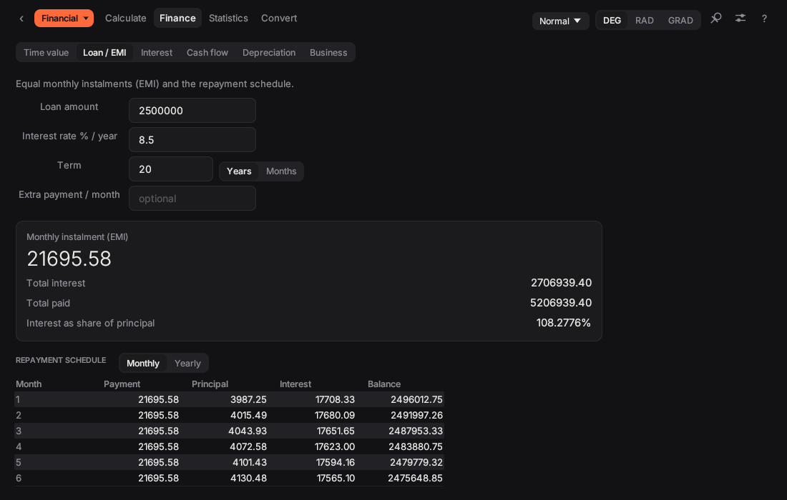
  &nbsp;
  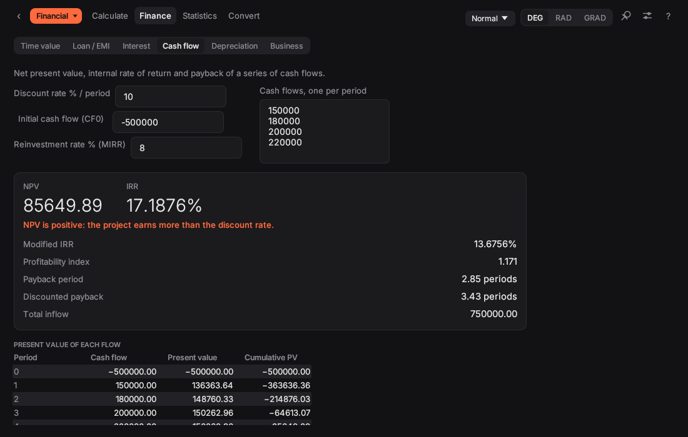
</p>

### Convert
- Units in 13 categories: length, area, volume, mass, temperature, speed, time, pressure, energy, power, force, angle and data
- Number bases: decimal, hexadecimal, octal and binary
- Physical constants (CODATA) you can click to use in a calculation

### Programmer
- One integer shown in HEX, DEC, OCT and BIN at the same time; type in any of them
- 8, 16, 32 or 64-bit words, signed (two's complement) or unsigned
- Click any bit to flip it
- AND, OR, XOR, NAND, NOR, NOT, shifts, rotates and wrapping arithmetic

### Everyday conveniences
- **Simple or full**: the app opens as a small calculator; the arrow expands it into the full
  scientific calculator, growing towards the middle of the screen so it never goes off screen
- **Copy results**: click a result to copy it; right-click for *Copy as shown*, *Copy calculation*
  or *Insert into the input*
- **History that is remembered**, together with `Ans` and stored variables
- **Settings**: System, Light or Dark appearance; digit grouping; decimal point or comma;
  keep on top; clear history
- **Input guide** (the `?` button) explains how to type powers, roots, functions and more, and
  every field and key has a tooltip
- **macOS menu bar** with View, Window and Help menus and the usual shortcuts
- Works offline, collects no data and needs no account

### Keyboard shortcuts

| Shortcut | Action |
| --- | --- |
| Return or `=` | Calculate |
| ↑ / ↓ | Recall earlier calculations |
| Esc | Clear the line |
| ⌘1 … ⌘9 (Ctrl on Windows/Linux) | The tabs of the current calculator type, left to right |
| ⌘0 | Simple / full calculator (macOS menu) |
| ⇧⌘C | Copy the last result |
| ⌘, | Settings (macOS menu) |
| ⌘? | Input guide (macOS menu) |

## Screenshots

| | |
| --- | --- |
| 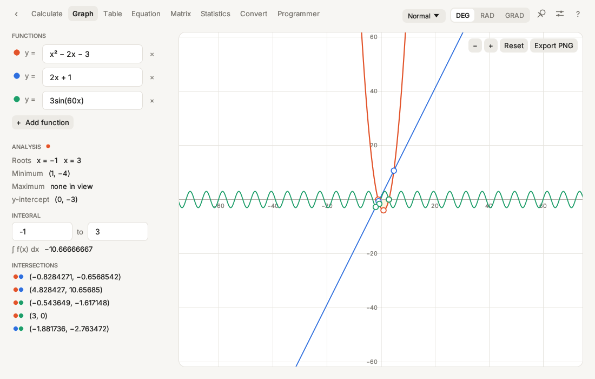 | 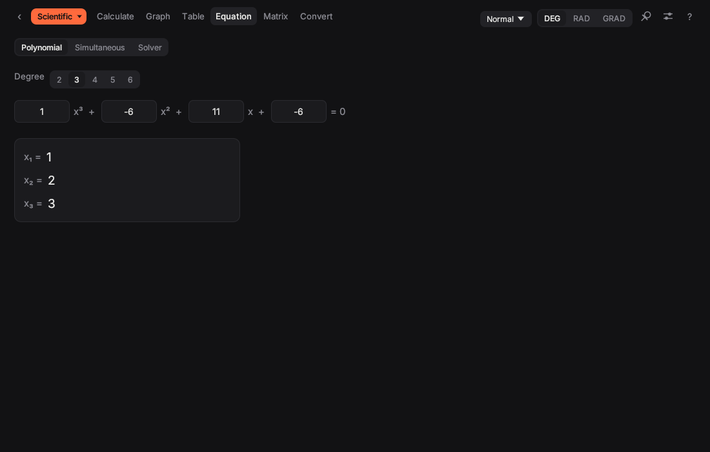 |
| 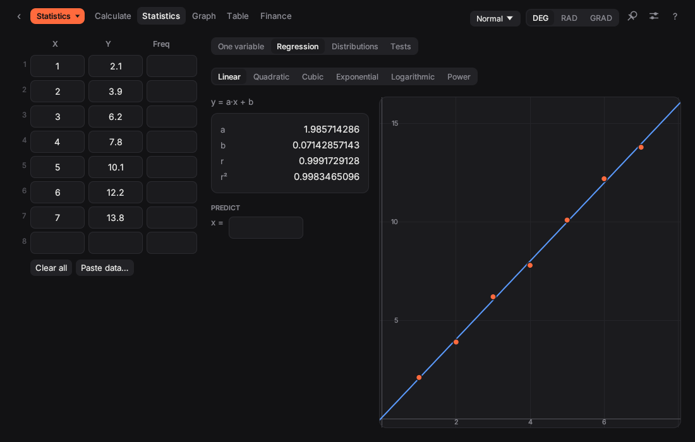 | 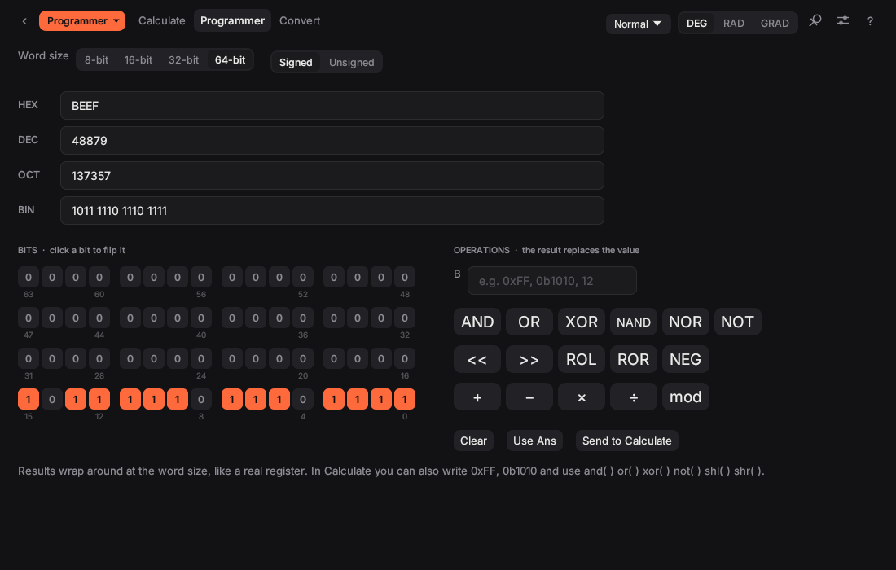 |
| 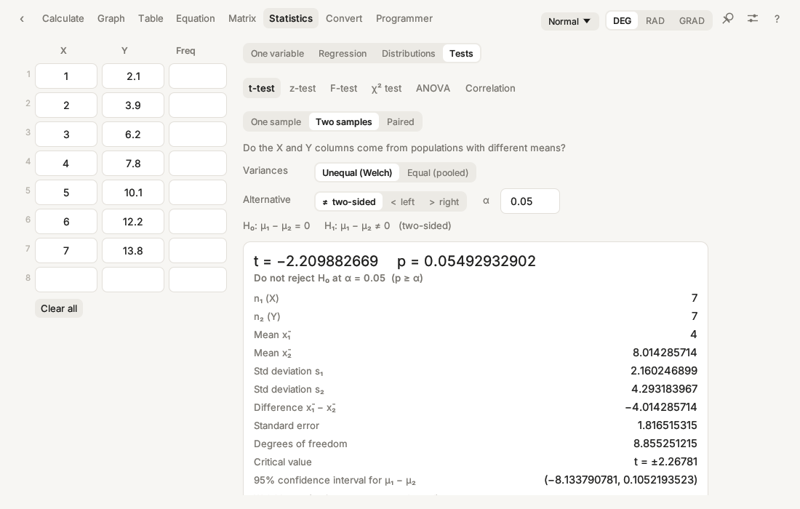 | 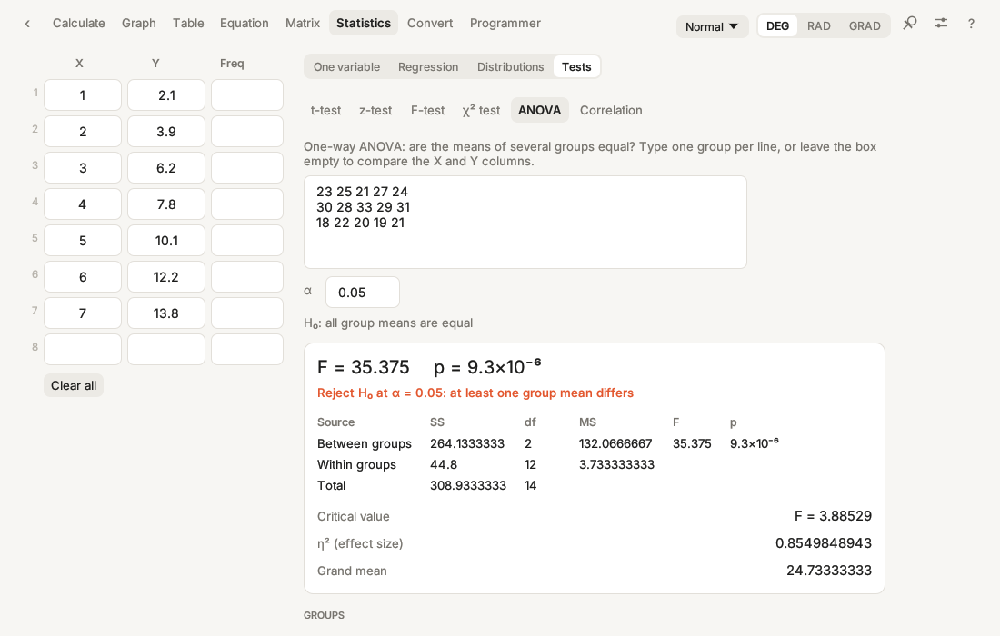 |
| 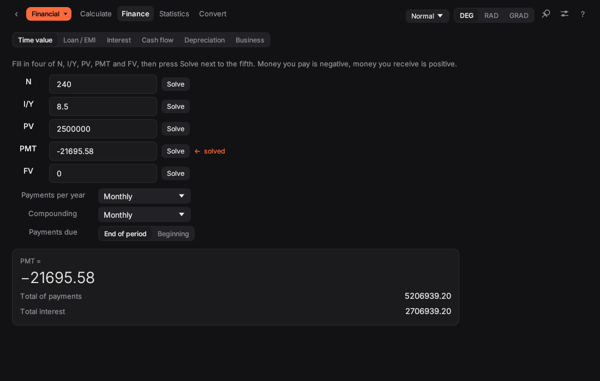 |  |
| 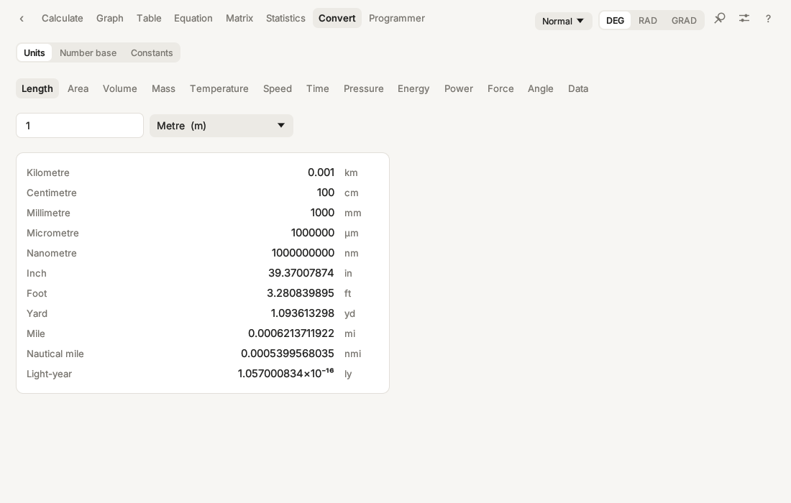 |  |

## Typing maths: quick reference

- Operators: `+ - * / ^ ! %` and implicit multiplication (`2π`, `3(4+1)`, `2sin(30)`)
- Store a value: `5 -> A`, then use `A` anywhere; `Ans` is the last result
- Functions: `sin cos tan asin acos atan sinh cosh tanh ln log log(b,x) exp sqrt cbrt root(n,x)
  abs arg conj round(x,n) gamma nCr nPr gcd lcm mod min max rand`
- Calculus: `diff(x^3, 2)`, `integ(x^2, 0, 3)`, `sum(k^2, k, 1, 10)`, `prod(k, k, 1, 5)`, `solve(x^2-2, 1)`
- Lists `{1,2,3}`, matrices `[[1,2],[3,4]]`, number bases `0xFF`, `0b1010`, `0o17`
- Distributions: `normpdf normcdf invnorm binompdf binomcdf poissonpdf poissoncdf tpdf tcdf invt chi2pdf chi2cdf invchi2 fpdf fcdf invf`

## Build from source

The app is written in Rust with [egui](https://github.com/emilk/egui).

**macOS**

```
bash build.sh
```

Builds `Scientific Calculator.app` in this folder (the script offers to install Rust if needed).

**Windows 10 / 11**

Double-click `build-windows.bat` (or run `.\build-windows.ps1` in PowerShell). It produces
`dist\Scientific-Calculator-<version>-Windows-Setup.exe`, an installer with a Start-menu entry,
an optional desktop shortcut and an uninstaller. The script installs what is missing with winget: Rust, Inno Setup and a
C++ linker (either Visual Studio Build Tools, or Rust's smaller GNU toolchain if you prefer not to
install Visual Studio).

**Linux**

```
cargo build --release
bash packaging/linux/package.sh
```

Produces a `.deb` package and a `.tar.gz` in `dist/`.

**Development:** `cargo run` starts the app, `cargo test` runs the maths engine tests.

### Automatic release builds

`.github/workflows/release.yml` builds the macOS disk image (universal: Apple silicon and Intel),
the Windows installer and the Linux packages, and attaches them to a GitHub release. Run it from
the **Actions** tab. When these repository secrets are set, the Mac app is also signed and
notarised by Apple:

| Secret | Value |
| --- | --- |
| `MACOS_CERT_P12` | *Developer ID Application* certificate exported as .p12, base64-encoded |
| `MACOS_CERT_PASSWORD` | Password of the .p12 |
| `APPLE_ID` | Apple ID email of the developer account |
| `APPLE_TEAM_ID` | 10-character team ID |
| `APPLE_APP_PASSWORD` | App-specific password from appleid.apple.com |

### Source layout

```
src/engine.rs     parser and evaluator         src/numeric.rs   calculus, roots, linear systems
src/matrix.rs     matrices                     src/stats.rs     statistics, regression, distributions
src/fmt.rs        number formatting            src/units.rs     units and constants
src/finance.rs    loans, TVM, cash flows       src/hypothesis.rs  t, z, F, χ² tests, ANOVA
src/theme.rs      colours and fonts            src/widgets.rs   shared controls
src/plot.rs       graph drawing                src/menu.rs      macOS menu bar
src/ui_*.rs       one file per mode            src/main.rs      window, top bar, settings
```

## Credits

Created by **Sopè Technology** · [sopetechnology.com](https://sopetechnology.com)  
© 2026 Sopè Technology. All rights reserved.
The interface font is [Inter](https://rsms.me/inter/) (SIL Open Font License, see `assets/Inter-LICENSE.txt`).
